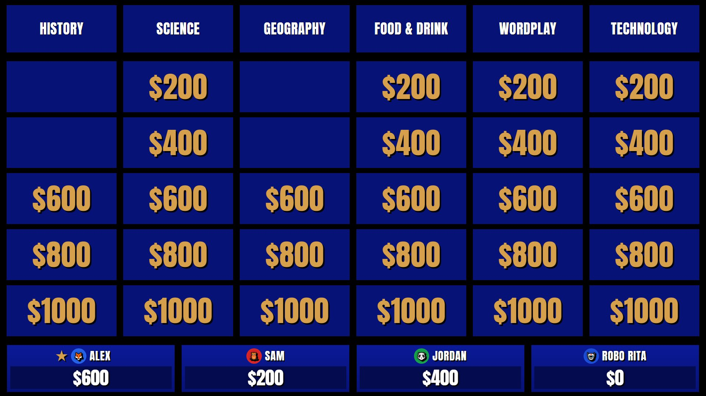
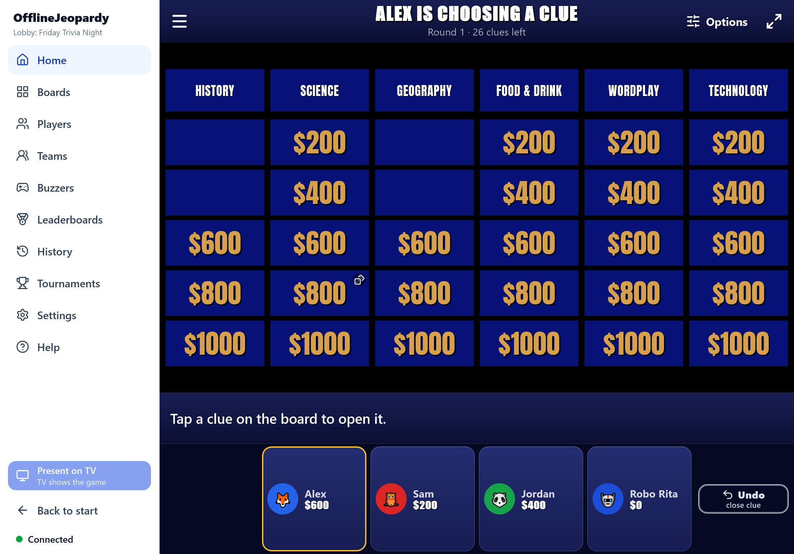
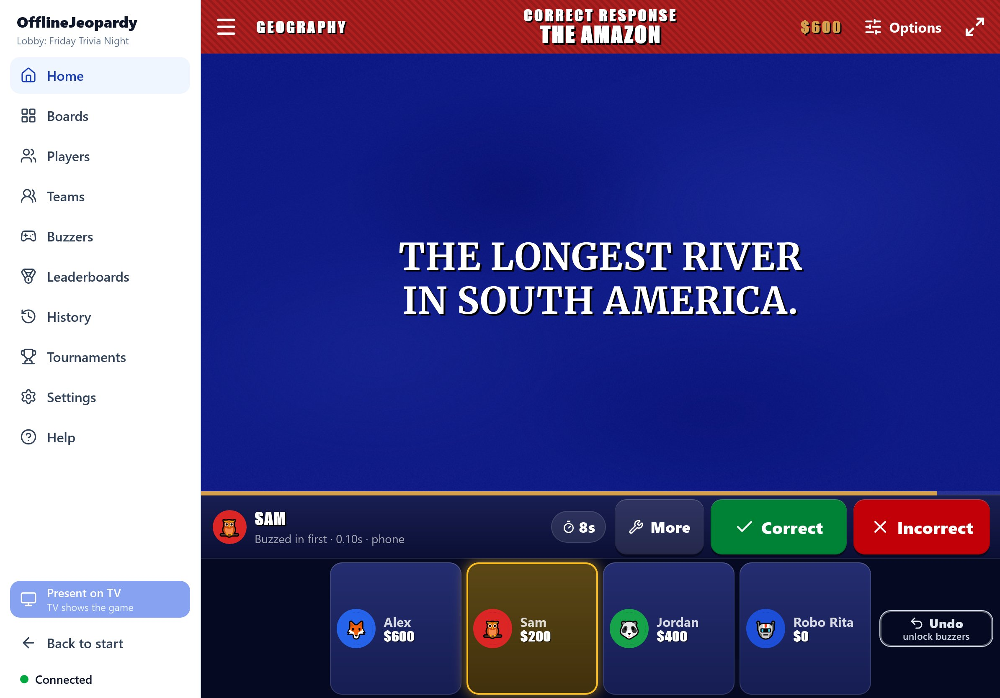
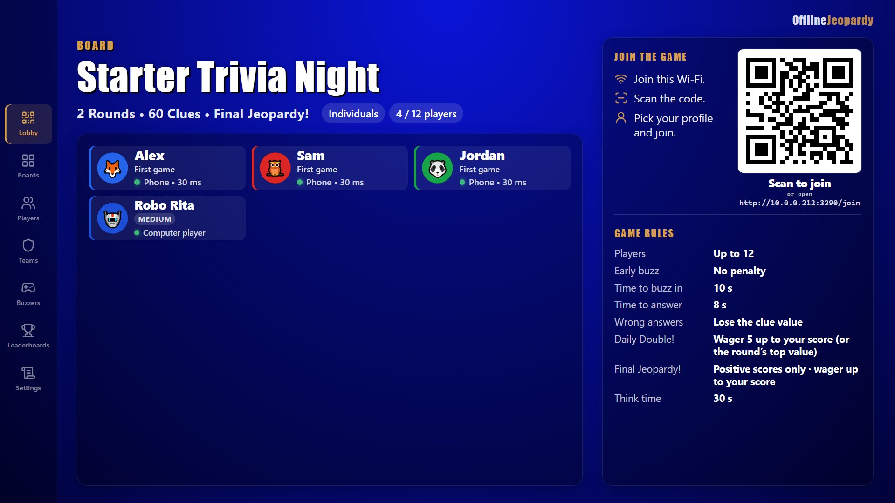
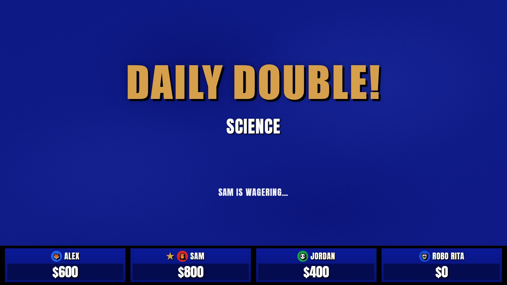
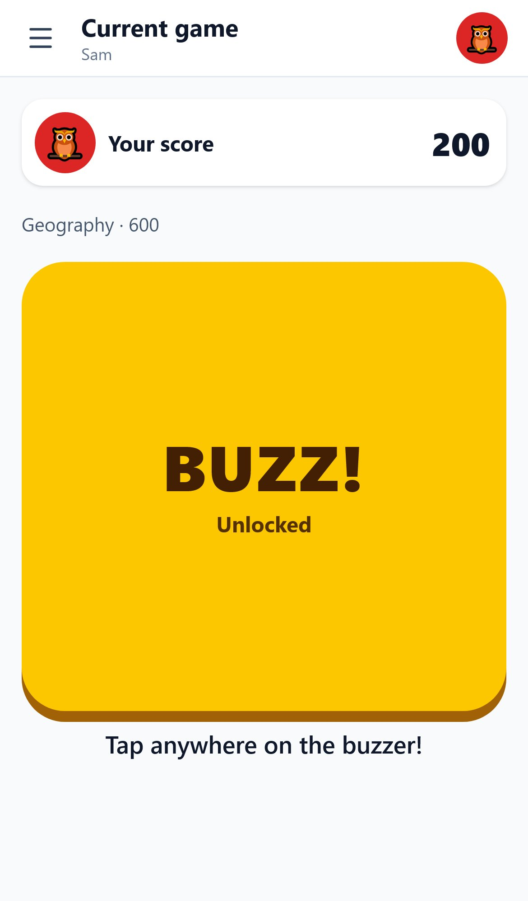
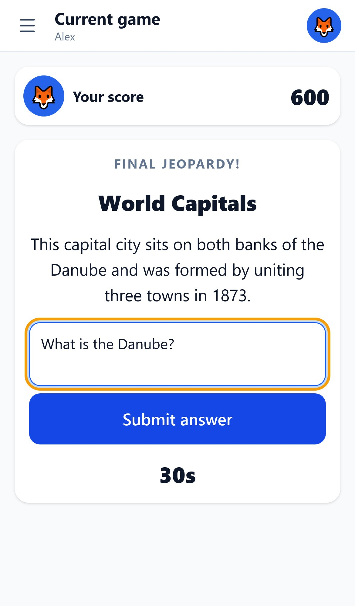
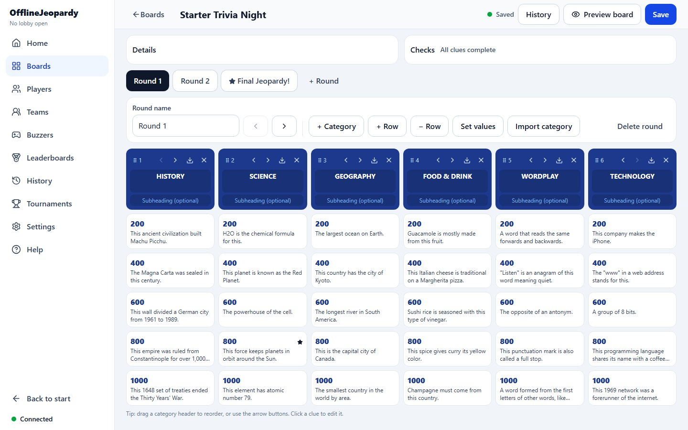
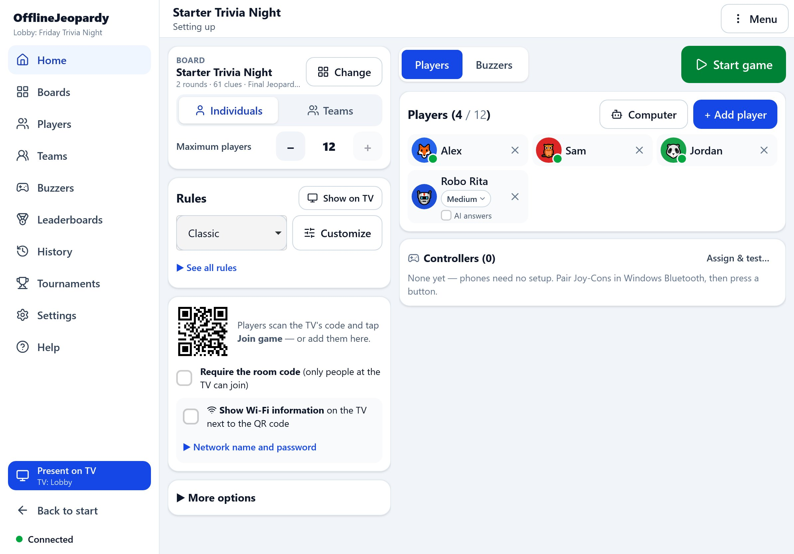
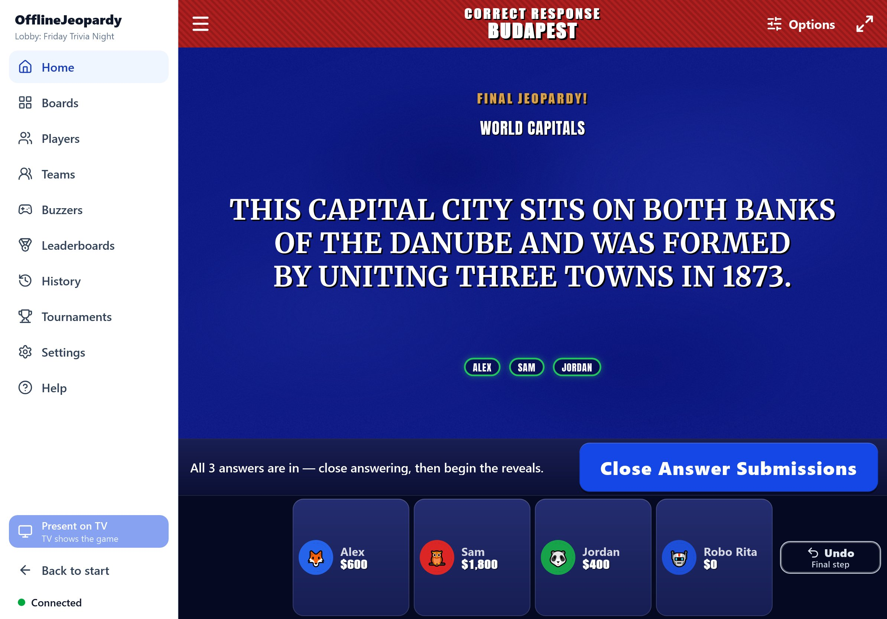

<div align="center">

# OfflineJeopardy

*A locally hosted, multiplayer Jeopardy-style game for game nights at home.*

[](https://github.com/geolaudy/OfflineJeopardy/releases/tag/v1.0.0)
[](#download-and-install)
[](#offline-first)



</div>

OfflineJeopardy turns a Windows PC and a TV into a quiz show. The PC shows the board on the TV,
the host runs the game from an iPad (or any tablet or computer) in the browser, and players buzz in with
their phones, Nintendo Switch Joy-Cons or keyboard keys. Everything runs on your own local network;
no internet connection, account or app store download is needed.

- **Public TV board** with clue animations, scores, Daily Doubles and Final Jeopardy!
- **Separate host controller** that shows the answers only to the host
- **Phone buzzers**: players scan one QR code, no app to install
- **Bluetooth Joy-Cons** and keyboard keys as buzzers
- **Custom game boards** with picture, sound and video clues
- **Player profiles** with PINs, statistics and game history
- **Teams and computer opponents**
- **Offline first**: core gameplay never needs the internet

---

## Contents

- [Screenshots](#screenshots)
- [Features](#features)
- [Download and install](#download-and-install)
- [Quick start](#quick-start)
- [Build from source](#build-from-source)
- [Known limitations](#known-limitations)
- [Contributing](#contributing)
- [License](#license)

## Screenshots

<table>
  <tr>
    <td width="50%"></td>
    <td width="50%"></td>
  </tr>
  <tr>
    <td align="center"><b>Host controller</b>: the iPad mirrors the TV and runs the game</td>
    <td align="center"><b>Judging a clue</b>: only the host sees the correct response</td>
  </tr>
  <tr>
    <td></td>
    <td></td>
  </tr>
  <tr>
    <td align="center"><b>Clue on the TV</b></td>
    <td align="center"><b>Lobby</b>: players join by scanning the QR code</td>
  </tr>
  <tr>
    <td></td>
    <td></td>
  </tr>
  <tr>
    <td align="center"><b>Daily Double!</b></td>
    <td align="center"><b>Final Jeopardy!</b></td>
  </tr>
</table>

<table>
  <tr>
    <td width="25%"></td>
    <td width="25%"></td>
    <td width="50%"></td>
  </tr>
  <tr>
    <td align="center"><b>Phone buzzer</b></td>
    <td align="center"><b>Final answer</b></td>
    <td align="center"><b>Board editor</b></td>
  </tr>
</table>

<details>
<summary>More: the host's lobby and Final Jeopardy! controls</summary>
<br>


</details>

The screenshots come from the real application, captured with `npm run screenshots`: a demo game
with the built-in starter board, a 1080p TV, an iPad Pro 11 in landscape and an iPhone 13.

## Features

### Local multiplayer
The Windows app starts a small web server on your PC. The TV, the host's tablet and the players' phones
connect to it over your Wi-Fi or Ethernet network, and the server decides everything: who buzzed first,
scores and timers. Every screen stays in sync live. A game that is interrupted (for example by a restart)
resumes where it left off.

### Host controller
The host scans the host QR code on the PC (or types the address), enters a 6-digit code and runs the game
from the browser: Safari on an iPad, or any tablet, phone or computer. The controller shows a live copy of
the TV and the correct responses, and has buttons to unlock buzzers, judge answers, adjust scores, undo and
control timers. It works embedded or full screen, in landscape and portrait, and can be added to the
iPad's Home Screen.

### Public TV presentation
The board opens full screen on the TV (or a projector). It introduces each round and its categories,
zooms clues out of their tiles, shows who buzzed first, timers and scores, and presents Daily Doubles and
Final Jeopardy! with sounds. The TV never shows an answer before the host reveals it. Eight built-in
themes can be customised (colours, fonts, background picture, logo).

### Phone buzzers
Players scan the single QR code on the TV (or type the address shown under it), pick their profile or
join as a guest, and get a full-screen buzzer. Phones also take Daily Double and Final Jeopardy! wagers
and answers. An optional room code makes sure only people who can see the TV join.

### Bluetooth controllers
Nintendo Switch Joy-Cons paired with the PC over Bluetooth work as buzzers (tested with real Joy-Cons on
Windows). Keys on the PC's keyboard work too. The host assigns a controller to each player or team, and
players can switch to their phone at any time. All buzzers, whatever the device, go through the same
buzzer engine with network-delay correction, so nobody has an advantage from their kind of buzzer.

### Custom game boards
The board editor creates and edits boards with any number of rounds, categories and values, Daily
Doubles and a Final Jeopardy! clue. Boards autosave, keep a version history and can be duplicated,
archived, imported (CSV, JSON or a board package) and exported. The built-in **Starter Trivia Night**
board lets you play right away.

### Media clues
Clues and responses can include pictures, sounds and videos. The TV plays them and the host controls
playback. A board can be exported as one `.ojboard.zip` package together with its media and imported on
another PC.

### Player profiles
Players create a profile on their phone with a name, colour, avatar or photo and a 4-digit PIN.
Profiles keep their statistics, leaderboards and a clue-by-clue history of every game. Renaming a
player or changing their picture never changes past games. Players can add a nickname for one game,
and guests can join without a profile.

### Teams and bots
Games are played by individuals or by teams. Each team chooses its own buzzer mode: everyone buzzes, or
one shared buzzer. Points belong to the team, and individual contributions are tracked separately.
Computer opponents (Easy, Medium, Hard, Expert) buzz, answer, wager and play Final Jeopardy! by
themselves, so you can also practise alone.

### Daily Doubles
The TV announces the Daily Double! and the host enters the player's wager (or lets the player enter it on
their phone). The clue then appears with the timer stopped so it can be read aloud, and the host starts
the answer time when ready.

### Final Jeopardy!
Players wager and answer on their phones (by default only players with a positive score take part). Submissions are locked once sent
(this can be changed in the settings), and the host can enter a wager or answer for a player without a
device. The host shows the clue, unlocks answering, and reveals each player's response and wager on the
TV before showing the winner.

### Offline first
Gameplay, profiles, statistics, boards, media and themes all work with no internet connection, and all
data stays on the game PC, in a folder you can choose in the settings. Backups are a single `.zip` file.

A few **optional** features use the internet, and only when you turn them on:

- **AI answers for computer opponents** through the Anthropic or Google Gemini API (needs your own API key
  and an internet connection). A local, OpenAI-compatible server such as Ollama or LM Studio works offline.
  Without AI, computer opponents answer offline.
- **Importing a board from a web link**: a direct link to a `.csv` or `.json` file, or a public
  Buzzinga.io share link. Importing files from the PC works offline.

## Download and install

Download the latest version from the
[**Releases page**](https://github.com/geolaudy/OfflineJeopardy/releases/latest). Each release has
two Windows builds:

| File | Use it when |
|---|---|
| `OfflineJeopardy-Setup-1.0.0.exe` | You want a normal installation with Start menu and desktop shortcuts. Fastest start-up. |
| `OfflineJeopardy-Portable-1.0.0.exe` | You don't want to install anything. Its data is kept in an `OfflineJeopardyData` folder next to the exe. |
| `SHA256SUMS.txt` | Checksums of both files. |

**Requirements:** Windows 10 or 11 (64-bit). The iPad and phones must be on the same network as the PC
(the internet is not needed). Joy-Cons need Bluetooth on the PC.

**Windows security prompts:**

- The executables are not code-signed, so Windows SmartScreen may say it *protected your PC*. Choose
  **More info → Run anyway**.
- The installer installs for all users and asks for administrator approval.
- When Windows Firewall asks, allow OfflineJeopardy on **private networks**. Otherwise the iPad and the
  phones cannot connect.

Updating keeps your boards, players and history.

## Quick start

1. **Start OfflineJeopardy** on the PC. It starts its local server automatically.
2. **Connect the TV**: connect it with HDMI, choose *Extend* (Win+P), and on the PC's Home screen choose
   **Open game board** on the TV screen. F11 toggles full screen.
3. **Connect the host controller**: on the iPad, scan the host QR code shown on the PC (or type the
   address, starting with `http://`) and enter the 6-digit host code. The iPad stays signed in.
4. **Create a lobby**: pick a board, choose individuals or teams and the rules.
5. **Players join with their phones**: they scan the QR code on the TV, pick or create their profile
   (or join as a guest) and tap **Join game**.
6. **Joy-Cons** (optional): pair each Joy-Con in Windows Bluetooth settings (hold the small sync button),
   then in the lobby's **Buzzers** tab assign it to a player and press one of its buttons.
7. **Start game**. Tap a clue, unlock the buzzers, judge the answer, and so on until Final Jeopardy!

The full guide, including troubleshooting for networks that block devices from seeing each other, is in
[docs/USER_GUIDE.md](docs/USER_GUIDE.md).

## Build from source

You need **Windows 10/11**, **[Node.js 24](https://nodejs.org/)** (with npm) and **Git**.

```bash
git clone https://github.com/geolaudy/OfflineJeopardy.git
cd OfflineJeopardy
npm ci                 # install the exact dependency versions from package-lock.json
npm start              # build and run the desktop app
npm run dist           # build the installer and the portable exe into release/
```

Development server, tests and packaging details: [docs/BUILDING.md](docs/BUILDING.md).

## Known limitations

- The Windows builds are not code-signed (see the SmartScreen note above).
- Joy-Cons from the original Nintendo Switch are supported. Nintendo Switch 2 Joy-Cons use different
  device ids and are not supported yet.
- Some routers (guest networks, "AP isolation") stop devices from seeing each other. Use another network,
  or the PC's Mobile Hotspot (the hotspot setup has not been tested on real hardware yet).
- When the host app is added to the iPad's Home Screen, iPadOS may draw the status bar above it in white
  instead of the app's colour. This is a WebKit limitation that web pages cannot change.
- Buzzer fairness corrects network delays; it cannot correct differences between input hardware (for example
  touch screens of different phone models).
- The portable exe unpacks itself on every start, so it starts more slowly than the installed app.

## Contributing

The `main` branch contains the latest stable release. **Active development happens on the
[`development`](https://github.com/geolaudy/OfflineJeopardy/tree/development) branch**:

```bash
git switch development
```

See [CONTRIBUTING.md](CONTRIBUTING.md) before proposing a change.

## License

Copyright © geolaudy. All rights reserved. OfflineJeopardy has no open-source license; the source is
published for reference and personal builds. Third-party components (Electron, React, Fastify, sharp
and others, listed in `package.json`) remain under their own licenses, and the bundled Anton and
Merriweather fonts under the SIL Open Font License.

OfflineJeopardy is an independent fan project. It is not affiliated with, endorsed by or connected to
*Jeopardy!*, Jeopardy Productions, Inc. or Sony Pictures Television. *Jeopardy!* is a trademark of its
respective owner. No show content, artwork or audio is included.
